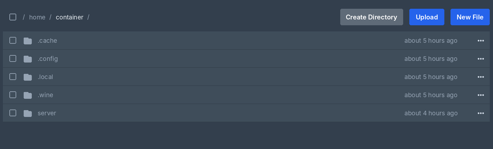
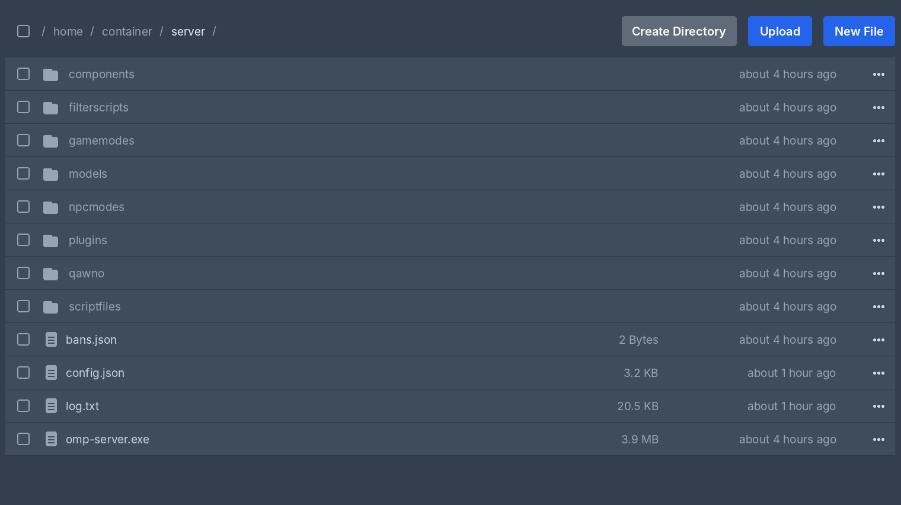

# open.mp (Windows/Wine) — Pterodactyl egg

[English](README.md) | Bahasa Indonesia

Egg Pterodactyl untuk menjalankan `omp-server.exe` (open.mp versi Windows) di host Linux memakai Wine. Egg ini tidak mengunduh file open.mp otomatis.

## Folder `server/`

Server dijalankan dari subfolder `server/`, bukan dari root folder server panel. Root itu adalah mount terpisah, dan Wine tidak bisa membaca path yang melewatinya sehingga `omp-server.exe` crash saat memuat komponen. Kalau file server masih di root, file yang dikenal (`omp-server.exe`, `components`, `config.json`, `gamemodes`, dst) dipindahkan ke `server/` otomatis saat start pertama.

Contoh tampilan file manager:

## Variabel

| Nama di panel | Variabel | Default | Keterangan |
|---------------|----------|---------|------------|
| Arsitektur Wine | `WINEARCH` | `win32` | `win32` untuk build x86 (rilis resmi saat ini), `win64` jika memakai build x86_64. Prefix dibuat ulang otomatis saat diganti. |
| Max players | `MAX_PLAYERS` | `50` | Jumlah slot pemain. Pemilik server hanya bisa melihat; admin mengubahnya di **Admin > Servers > (server) > Startup**. |
