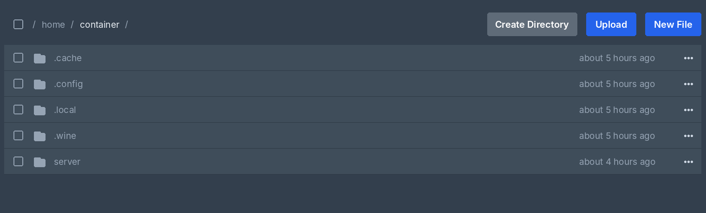
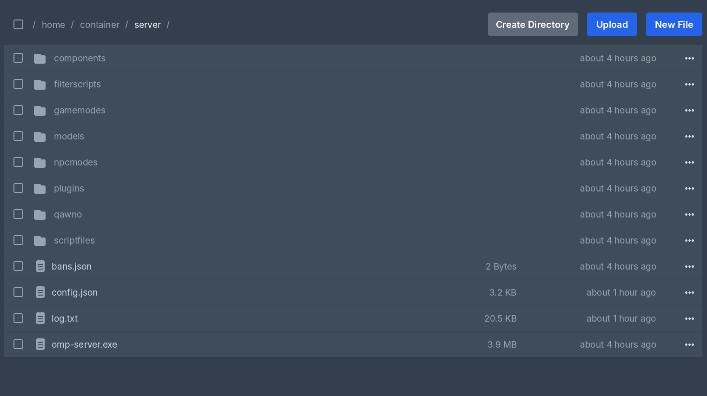

# open.mp (Windows/Wine) — Pterodactyl egg

English | [Bahasa Indonesia](README.id.md)

Pterodactyl egg for running `omp-server.exe` (the Windows build of open.mp) on a Linux host using Wine. This egg does not download open.mp files automatically.

## The `server/` folder

The server runs from the `server/` subfolder, not from the panel's server root. The root is a separate mount, and Wine cannot read paths that pass through it, which makes `omp-server.exe` crash while loading components. If the server files are still in the root, the known files (`omp-server.exe`, `components`, `config.json`, `gamemodes`, etc.) are moved into `server/` automatically on the first start.

Example file manager view:

## Variables

| Name in panel | Variable | Default | Description |
|---------------|----------|---------|-------------|
| Arsitektur Wine (Wine architecture) | `WINEARCH` | `win32` | `win32` for the x86 build (the current official release), `win64` if using an x86_64 build. The prefix is recreated automatically when this changes. |
| Max players | `MAX_PLAYERS` | `50` | Player slots. Server owners can only view it; admins change it in **Admin > Servers > (server) > Startup**. |
